# ha-vehicle-consumption

[](https://github.com/hacs/integration)
[](https://github.com/juju35/ha-vehicle-consumption/actions/workflows/hacs.yml)
[](https://github.com/juju35/ha-vehicle-consumption/actions/workflows/validate.yml)
[](https://github.com/juju35/ha-vehicle-consumption/releases/latest)
[](LICENSE)

<p align="center">
  <picture>
    <source media="(prefers-color-scheme: dark)" srcset="custom_components/vehicle_consumption/brand/dark_logo.png">
    
  </picture>
</p>

Home Assistant integration that turns your car's own sensors into a **fuel and energy logbook**: consumption in **L/100 km or kWh/100 km** per trip, per month and on average, **refuels and charges detected on their own**, and what driving **costs you per kilometre**. Fuel, electric and plug-in hybrid vehicles alike.

It comes with a **Lovelace card** showing the tank and battery gauges, the key figures, a monthly chart and your recent trips and refuels.

[](https://my.home-assistant.io/redirect/hacs_repository/?owner=juju35&repository=ha-vehicle-consumption&category=integration)

| Fuel car | Electric car |
|---|---|
|  |  |

## Features

- **One entry per vehicle**, set up from its device: the odometer and the fuel and battery sensors are **detected automatically**, or you pick them yourself
- **Fuel, electric and plug-in hybrid**: fuel used (L) and energy used (kWh) worked out from the level changes; miles, US gallons and Wh converted
- **Refuels and charges detected** when the level jumps up (3 L / 1 kWh by default), small sensor jitters ignored
- **Trips**: a trip starts when the odometer moves and ends after a gap without driving (30 minutes by default), with its distance, consumption and cost
- **Consumption** in L/100 km and kWh/100 km for the last trip, the current month and on average
- **Cost**: fuel and electricity prices from a sensor (such as [ha-carburants-france](https://github.com/juju35/ha-carburants-france)) or fixed; cost of the month and **cost per km**
- **History** kept across restarts: the last 24 months, 20 trips, 20 refuels and 20 charges
- **Actions** to log a refuel or a charge by hand (`add_refuel`, `add_charge`) to start over (`reset_statistics`) or to rebuild everything from the recorded history (`import_history`)
- **Lovelace card bundled with the integration**, added automatically to the dashboard resources (nothing to add by hand): fuel and battery gauges, trip / month / average / cost per km tiles, monthly chart (consumption, distance or cost), recent trips and refuels or charges, a pulsing dot while driving, a popup to log a refuel or a charge; visual editor
- UI setup, no YAML; English, French, German, Spanish, Italian, Dutch, Portuguese, Polish and Serbian (Cyrillic and Latin)

## Compatible integrations

The odometer and the fuel and battery sensors of these integrations are **detected from their own sensor keys**, read from each integration's source code. The setup form comes prefilled; check it and change what you want.

| Brand | Integration | Odometer | Fuel | Battery |
|---|---|---|---|---|
| Renault, Dacia, Alpine | [Renault](https://www.home-assistant.io/integrations/renault/) (official) | ✓ | litres | kWh, % |
| Tesla | [Tesla Fleet](https://www.home-assistant.io/integrations/tesla_fleet/), [Teslemetry](https://www.home-assistant.io/integrations/teslemetry/), [Tessie](https://www.home-assistant.io/integrations/tessie/) (official) | ✓ ¹ | — | kWh ², % |
| Kia, Hyundai, Genesis | [Kia Connect / Hyundai Bluelink](https://github.com/Hyundai-Kia-Connect/kia_uvo) (HACS) | ✓ | % | kWh, % |
| BMW, Mini | [BMW Connected Drive](https://www.home-assistant.io/integrations/bmw_connected_drive/) (official until 2026.3), [BMW CarData](https://github.com/kvanbiesen/bmw-cardata-ha), [BavarianData](https://github.com/JustChr/BavarianData) (HACS) | ✓ | litres, % | % |
| Mercedes-Benz, smart | [MercedesME 2020](https://github.com/ReneNulschDE/mbapi2020) (HACS) | ✓ | % | % |
| Toyota, Lexus | [Toyota](https://github.com/pytoyoda/ha_toyota) (HACS) | ✓ | % | % |
| Volvo | [Volvo](https://www.home-assistant.io/integrations/volvo/) (official), [Volvo Cars](https://github.com/thomasddn/ha-volvo-cars) (HACS, former) | ✓ | litres | % |
| Polestar | [Polestar API](https://github.com/pypolestar/polestar_api) (HACS) | ✓ | — | % |
| Volkswagen | [Volkswagen Car-Net](https://github.com/robinostlund/homeassistant-volkswagencarnet), [Volkswagen We Connect ID](https://github.com/mitch-dc/volkswagen_we_connect_id) (HACS) | ✓ | % | % |
| Audi | [Audi connect](https://github.com/audiconnect/audi_connect_ha) (HACS) | ✓ | % | % |
| Škoda | [MySkoda](https://github.com/skodaconnect/homeassistant-myskoda) (HACS) | ✓ | % | % |
| SEAT, CUPRA | [SEAT Connect](https://github.com/Farfar/homeassistant-seatconnect), [CUPRA We Connect](https://github.com/daernsinstantfortress/cupra_we_connect) (HACS) | ✓ | % | % |
| Peugeot, Citroën, DS, Opel, Fiat, Jeep, Alfa Romeo | [Stellantis Vehicles](https://github.com/andreadegiovine/homeassistant-stellantis-vehicles) (HACS) | ✓ | % | kWh, % |
| Ford | [FordPass](https://github.com/itchannel/fordpass-ha) (HACS) | ✓ | % ³ | — |
| Nissan | [Nissan Leaf](https://www.home-assistant.io/integrations/nissan_leaf/) (official) | — ⁴ | — | % |
| MG | [MG SAIC](https://github.com/ad-ha/mg-saic-ha) (HACS) | ✓ | % | kWh, % |
| BYD | [BYD Vehicle](https://github.com/jkaberg/hass-byd-vehicle) (HACS) | ✓ | % | % |
| Any (OBD-II) | [WiCAN](https://github.com/jay-oswald/ha-wican), [OVMS](https://github.com/ovms-hass/ovms-home-assistant) (HACS) | ✓ | litres, % ⁵ | % |

¹ Disabled by default in Tesla Fleet and Teslemetry: enable the *Odometer* entity first. ² Teslemetry and Tessie. ³ On an electric Ford, FordPass reports the battery level there. ⁴ The Leaf integration has no odometer: pick one from another source. ⁵ WiCAN, depending on the vehicle profile.

**Any other vehicle integration** works too, as long as its device has an **odometer** plus **fuel** sensors (litres or gallons, or a level in %) and/or **battery** sensors (kWh, or a level in %): they are recognised from their names, units and device classes, or picked by hand. Units are converted (miles and metres to km, US gallons to litres, Wh, kJ and MJ to kWh). A level in % needs the tank or battery capacity to be turned into litres or kWh. The setup starts from the vehicle's device, so sensors without one (Torque) cannot be used.

### Home chargers

For an electric or plug-in hybrid car, the energy counter of your home charger is found automatically (it is another device) and measures home charges at the charger, losses included:

- **evcc** ([HACS `evcc_intg`](https://github.com/marq24/ha-evcc)): *Charged (Total)* of the loadpoint, else *Session energy* / *Charge energy*
- **Easee** ([HACS](https://github.com/fondberg/easee_hass)): *Lifetime energy*, else *Session energy*
- **Zaptec** ([HACS](https://github.com/custom-components/zaptec)): *Energy meter*, else *Session total charge*
- **Wallbox** ([official integration](https://www.home-assistant.io/integrations/wallbox/)): *Added energy*
- **Ohme** ([official integration](https://www.home-assistant.io/integrations/ohme/)): *Energy* (Home Assistant before 2026.7)

Any other energy sensor (kWh or Wh) that counts what the charger delivers works too, picked by hand: a total counter or a session counter that goes back to 0.

## Prerequisites

- Home Assistant 2024.12 or newer
- A vehicle integration with an odometer and at least one fuel or battery sensor

## Installation

### Via HACS (recommended)

[](https://my.home-assistant.io/redirect/hacs_repository/?owner=juju35&repository=ha-vehicle-consumption&category=integration)

Or manually:

1. Open HACS → **⋮** → **Custom repositories**
2. Add `https://github.com/juju35/ha-vehicle-consumption` — Type: **Integration**
3. Search for **Vehicle Consumption** and download it
4. Restart Home Assistant

### Manual

1. Download `vehicle_consumption.zip` from the [latest release](https://github.com/juju35/ha-vehicle-consumption/releases/latest)
2. Unzip it into `/config/custom_components/vehicle_consumption/`
3. Restart Home Assistant

### Removal

Remove each vehicle from **Settings → Devices & services**: its stored history is deleted with it, and the card resource is removed with the last one. Then remove the repository from HACS.

## Configuration

**Settings → Devices & services → Add integration → Vehicle Consumption**, once per vehicle:

1. Pick the **vehicle** (its device from the car integration) and give it a name
2. Check the **sensors**: the odometer and the fuel and battery sensors found on the device are filled in; change or complete them if needed
3. Set the **prices** (a price sensor, such as a station of [ha-carburants-france](https://github.com/juju35/ha-carburants-france), or a fixed price)

Everything can be changed later with **Configure**, which also holds the trip and refuel/charge thresholds.

| Option | Default | Description |
|---|---|---|
| Odometer | Detected | Total distance sensor (km or mi), required |
| Fuel quantity | Detected | Fuel left in the tank (L or gal) |
| Fuel level | Detected | Fuel left in % (needs the tank capacity) |
| Battery energy | Detected | Energy left in the battery (kWh or Wh) |
| Battery level | Detected | Battery level in % (needs the battery capacity) |
| Tank capacity | — | Litres, to turn a fuel level in % into litres |
| Usable battery capacity | — | Usable kWh, to turn a battery level in % into kWh |
| Charger energy | Detected | Energy counter of your home charger (total or per session, kWh); needs a battery sensor. Home charges are measured at the charger, losses included |
| Fuel price sensor | — | Sensor giving the price per litre (wins over the fixed price) |
| Fixed fuel price | — | Price per litre, when there is no price sensor |
| Electricity price sensor | — | Sensor giving the price per kWh (wins over the fixed price) |
| Fixed electricity price | — | Price per kWh, when there is no price sensor |
| End of trip after | `30` min | Minutes without the odometer moving that end a trip |
| Refuel threshold | `3` L | A rise of at least this much fuel is a refuel |
| Charge threshold | `1` kWh | A rise of at least this much energy is a charge |

At least one fuel or battery sensor is needed. A vehicle with only fuel sensors is tracked as **fuel**, with only battery sensors as **electric**, with both as **plug-in hybrid**.

### Entities

One device per vehicle; the entities only exist when they make sense for it (`fuel_*` with fuel sensors, `energy_*` with battery sensors). For a vehicle named *My car*:

| Entity | Description |
|---|---|
| `sensor.my_car_consumption` | Average consumption (L/100 km, or kWh/100 km for an electric car). Its attributes carry everything the card shows: `vehicle`, `entry_id`, `kind`, `currency`, current levels and prices, `driving`, `trip`, `month`, `total`, `months`, `trips`, `refuels`, `charges` |
| `sensor.my_car_fuel_consumption_trip`, `sensor.my_car_fuel_consumption_this_month`, `sensor.my_car_average_fuel_consumption` | Fuel consumption of the last trip, this month and on average (L/100 km) |
| `sensor.my_car_energy_consumption_trip`, `sensor.my_car_energy_consumption_this_month`, `sensor.my_car_average_energy_consumption` | Energy consumption of the last trip, this month and on average (kWh/100 km) |
| `sensor.my_car_trip_distance`, `sensor.my_car_distance_this_month` | Distance of the last trip and this month (km) |
| `sensor.my_car_fuel_used_this_month` | Fuel used this month (L) |
| `sensor.my_car_energy_used_this_month` | Energy used this month (kWh) |
| `sensor.my_car_cost_this_month` | Cost of the fuel and energy used this month |
| `sensor.my_car_cost_per_km` | Cost per kilometre, on average |
| `sensor.my_car_last_refuel` | Time of the last refuel; attributes `liters`, `cost`, `odometer`, `source` (`auto` or `manual`) |
| `sensor.my_car_last_charge` | Time of the last charge; attributes `energy`, `cost`, `odometer`, `source` (`auto`, `charger` or `manual`) |

### Actions

#### `vehicle_consumption.add_refuel`

Logs a refuel by hand: it shows up in the card's refuels with source `manual`. Consumption still comes from the sensors, so a manual refuel does not change it. Fields: `config_entry_id` (the vehicle, required), `liters` (required), `cost` (total), `price` (per litre), `odometer`.

```yaml
action: vehicle_consumption.add_refuel
data:
  config_entry_id: 01JC0EXAMPLE0000000000000
  liters: 42.5
  cost: 74.80
```

For example from an automation, when a fuel card notification or a script tells you what you paid:

```yaml
triggers:
  - trigger: event
    event_type: fuel_receipt
actions:
  - action: vehicle_consumption.add_refuel
    data:
      config_entry_id: 01JC0EXAMPLE0000000000000
      liters: "{{ trigger.event.data.liters }}"
      price: "{{ trigger.event.data.price }}"
      odometer: "{{ states('sensor.my_car_mileage') | float(0) }}"
```

#### `vehicle_consumption.add_charge`

Same for a charge: `config_entry_id`, `energy` (kWh, required), `cost`, `price` (per kWh), `odometer`.

```yaml
action: vehicle_consumption.add_charge
data:
  config_entry_id: 01JC0EXAMPLE0000000000000
  energy: 31.2
  price: 0.2516
```

#### `vehicle_consumption.reset_statistics`

Clears the trips, months, refuels, charges and totals of a vehicle and starts over.

```yaml
action: vehicle_consumption.reset_statistics
data:
  config_entry_id: 01JC0EXAMPLE0000000000000
```

#### `vehicle_consumption.import_history`

Rebuilds the trips, months, refuels and charges of a vehicle from what Home Assistant recorded of its sensors over the last `days` (60 by default, up to 730). The [recorder](https://www.home-assistant.io/integrations/recorder/)'s states are used where it still has them (10 days by default); before them, the hourly long-term statistics of the sensors stand in (kept for good for sensors with a state class: the hourly state of a mileage or a fuel quantity, the hourly mean of a level in % or a price), so older trips are found to the hour. Those hours are only used once the odometer and every fuel or battery sensor that does the counting have statistics: a level without a state class has none, and the import then starts with the recorded states. Refuels and charges logged by hand are kept. It runs on its own once, over 60 days, when the vehicle is added, so the card is filled from the first day.

```yaml
action: vehicle_consumption.import_history
data:
  config_entry_id: 01JC0EXAMPLE0000000000000
  days: 60
```

### Card

The card is added to the dashboard resources by the integration. Add it from the dashboard (**Add card → Vehicle Consumption Card**) or in YAML:

```yaml
type: custom:vehicle-consumption-card
entity: sensor.my_car_consumption
```

| Option | Default | Description |
|---|---|---|
| `entity` | Auto | The vehicle: its **Consumption** sensor. Leave empty for the first vehicle |
| `title` | Vehicle name | Card title |
| `chart` | `true` | Monthly bar chart |
| `chart_metric` | `consumption` | What the chart shows: `consumption`, `distance` or `cost` |
| `months` | `6` | Number of months in the chart (3–12) |
| `trips` | `true` | **Recent trips** section |
| `refuels` | `true` | **Refuels** / **Charges** section |
| `add_button` | `true` | **+** button in the header to log a refuel or a charge |
| `language` | Auto | Force language: `en`, `fr`, `de`, `es`, `it`, `nl`, `pt`, `pl`, `sr` (Serbian, Cyrillic) or `sr-Latn` (Serbian, Latin) |

In the visual editor, **Vehicle** lists every vehicle set up in Vehicle Consumption, by name: nothing to look up, and a vehicle added later shows up in the list. The card picker previews the card with your first vehicle.

The **+** button opens a popup at the top of the card to log a refuel (litres) or a charge (kWh), its total cost and, optionally, the odometer. The sections fold and unfold with a tap, and fold back on their own when you tap elsewhere.

## Screenshots

The card animates in three places, and stays still with `prefers-reduced-motion`:

- **Gauges**: the fuel and battery gauges fill up to their level when the card appears

  | Light | Dark |
  |---|---|
  | 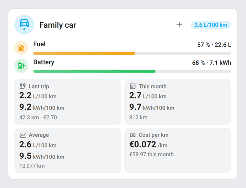 | 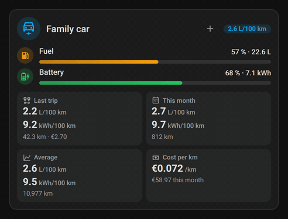 |

- **Chart**: the monthly bars grow from the bottom, the current month in the accent colour

  | Light | Dark |
  |---|---|
  | 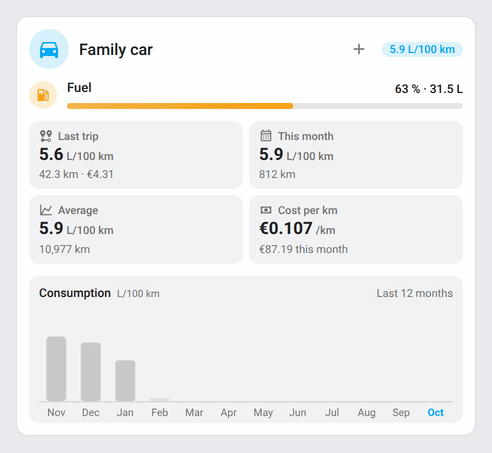 | 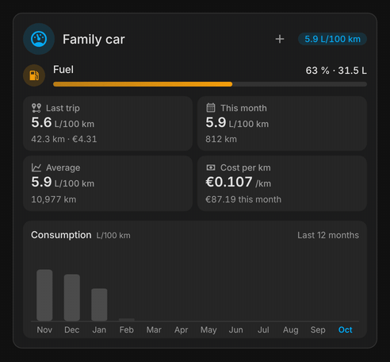 |

- **Driving**: while a trip is in progress, a dot pulses in the header

  | Light | Dark |
  |---|---|
  | 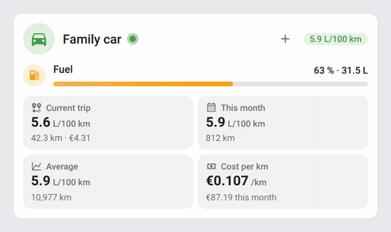 | 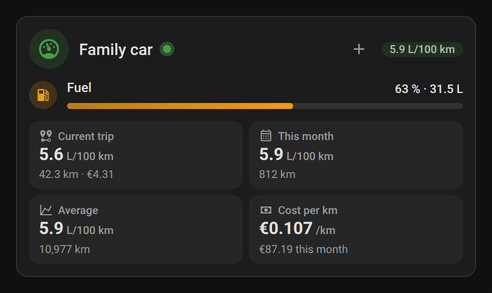 |

| Fuel car | Electric car |
|---|---|
| 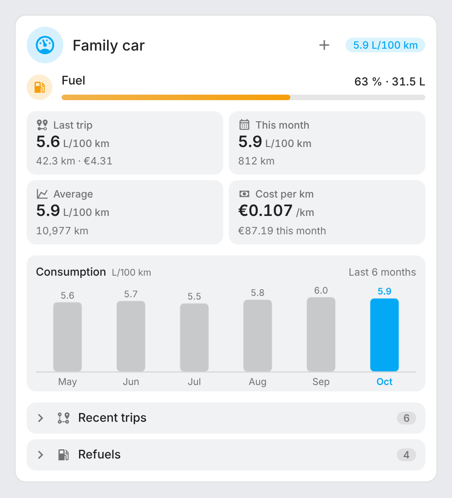 | 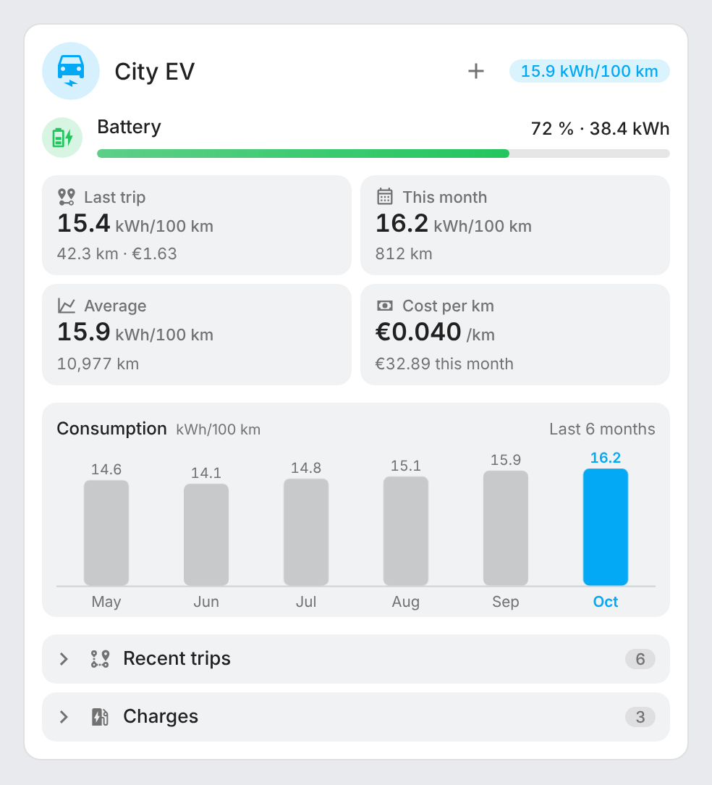 |
| 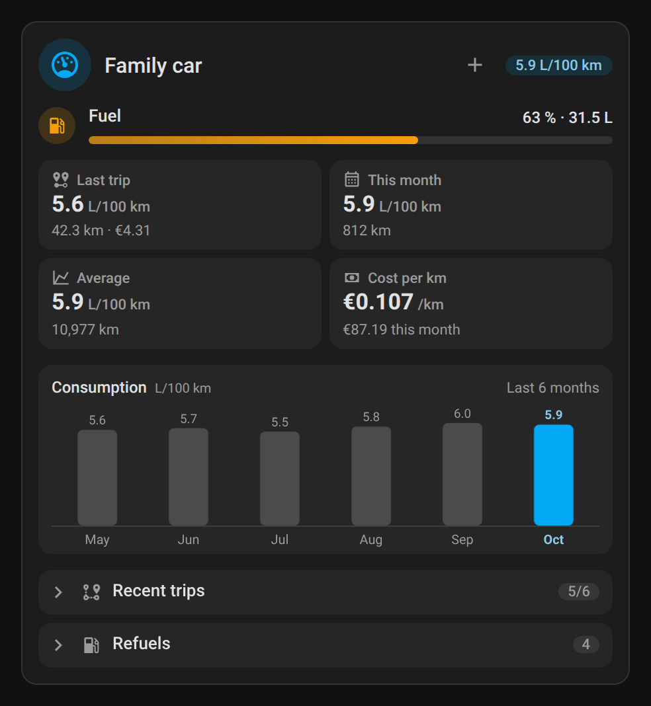 | 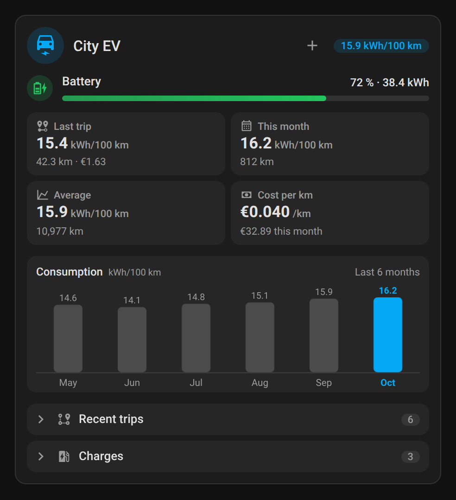 |

| Plug-in hybrid | Add a refuel |
|---|---|
| 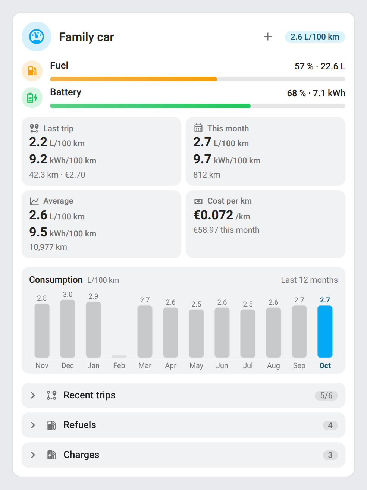 | 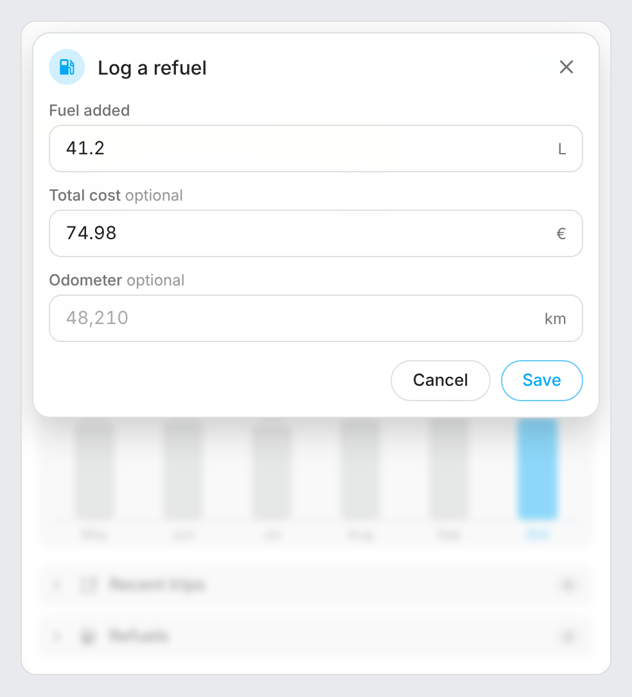 |
| 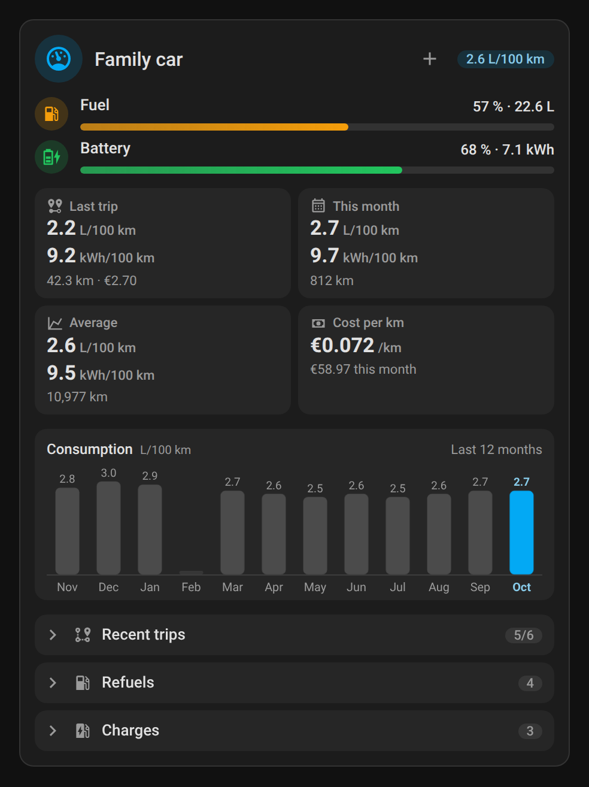 | 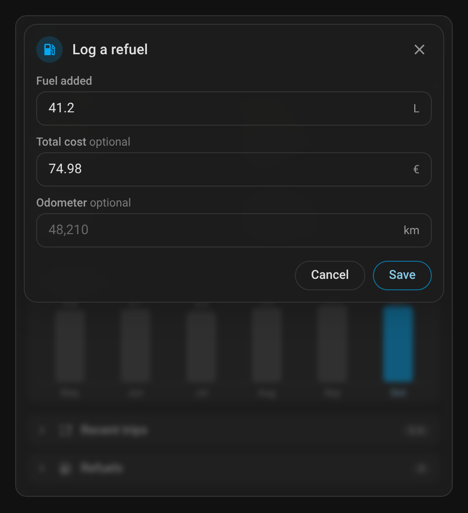 |

Recent trips and refuels unfolded:

| Light | Dark |
|---|---|
| 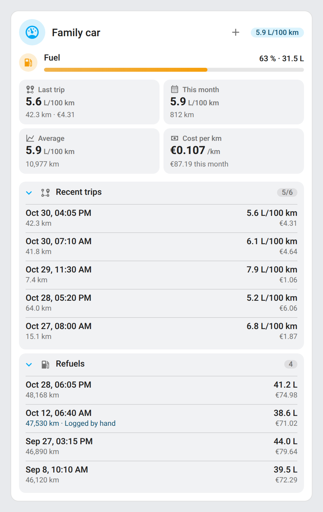 | 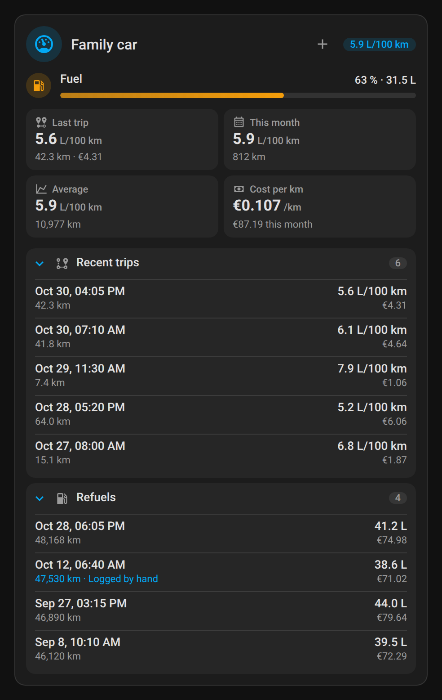 |

## How it works

Vehicle Consumption follows the levels reported by the car rather than asking you to log every refuel.

When a vehicle is added, the last 60 days of its sensors are replayed once, in order, as if the integration had been there: the past trips, refuels and charges are found the same way, at the prices of then when a price sensor is used (its value when the period starts, else the first one recorded). The recorded states give every reading (as long as the recorder keeps them, `purge_keep_days`: 10 days by default); before them, the hourly statistics give one reading an hour, so a trip there only ends after an hour parked.

- **Reference level**: for fuel (L) and energy (kWh), it keeps a reference level. When a reading goes **down**, the difference is counted as used and the reference follows. When it goes **up by at least the threshold** (3 L / 1 kWh by default), it is a **refuel or a charge**: the amount added is recorded, with its cost at the current price. A **smaller rise** is sensor noise (a tank sloshing, a battery warming up) and is ignored. `unknown` and `unavailable` readings are skipped. A level in % is turned into litres or kWh with the capacity you set; when a quantity (L) or energy (kWh) sensor is set too, the level is only shown, the quantity does the counting. A sensor can be used for one source only.
- **Home charger**: with a charger energy counter, a **home charge** is the counter going up, until it has not moved for 30 minutes. Its amount is what the counter delivered (losses included; a session counter going back to 0 starts a new session) and its cost that amount × the electricity price; it is listed as *Home charger*. A battery rise while the counter moves is that session, never counted twice; a battery rise while the charger is idle is a charge away from home, recorded as before. The energy used still comes from the battery going down.
- **Distance**: every rise of the odometer is added up (a jump over 2000 km is ignored as a glitch).
- **Trips**: a trip starts when the odometer moves and ends after the **trip gap** (30 minutes by default) without moving. Its distance, fuel, energy and cost are what was counted between its start and its end.
- **Prices**: the fuel price per litre and the electricity price per kWh come from a **sensor** (such as the station prices of [ha-carburants-france](https://github.com/juju35/ha-carburants-france), or your electricity tariff) or a **fixed** value; a sensor wins over the fixed price. Without a price, cost stays empty.
- **Consumption** is the amount used divided by the distance, × 100. Under **5 km** it is not shown: too short to mean anything.
- **History**: months are kept for 24 months (local time), and the last 20 trips, refuels and charges. Everything is stored in `.storage/vehicle_consumption.<entry_id>` and survives restarts.

## Development

```bash
pip install -r requirements_test.txt && pytest
node --test test/*.test.mjs   # card tests
python scripts/screenshots.py  # renders the card with mock vehicles into screenshots/ (also makes the GIFs, needs ffmpeg)
```

### Releasing

1. Bump the version in `custom_components/vehicle_consumption/manifest.json`, `const.py` (`VERSION`) and the card (`VEHICLE_CONSUMPTION_CARD_VERSION`)
2. Add a `## <version>` section at the top of [CHANGELOG.md](CHANGELOG.md)
3. Push to `main`: the **Release** workflow creates the tag and the GitHub release with the changelog section as notes, and attaches `vehicle_consumption.zip`

## Translations

The integration and the card follow the language of Home Assistant (Serbian in Latin script when Home Assistant is set to `sr-Latn`; `pt-BR` uses the European Portuguese texts). Currently supported:

| Language | Code |
|---|---|
| English | `en` |
| Français | `fr` |
| Deutsch | `de` |
| Español | `es` |
| Italiano | `it` |
| Nederlands | `nl` |
| Português (Portugal) | `pt` |
| Polski | `pl` |
| Српски (Serbian, Cyrillic) | `sr` |
| Srpski (Serbian, Latin) | `sr-Latn` |

Contributions for additional languages are welcome!

## License

[MIT](LICENSE)
